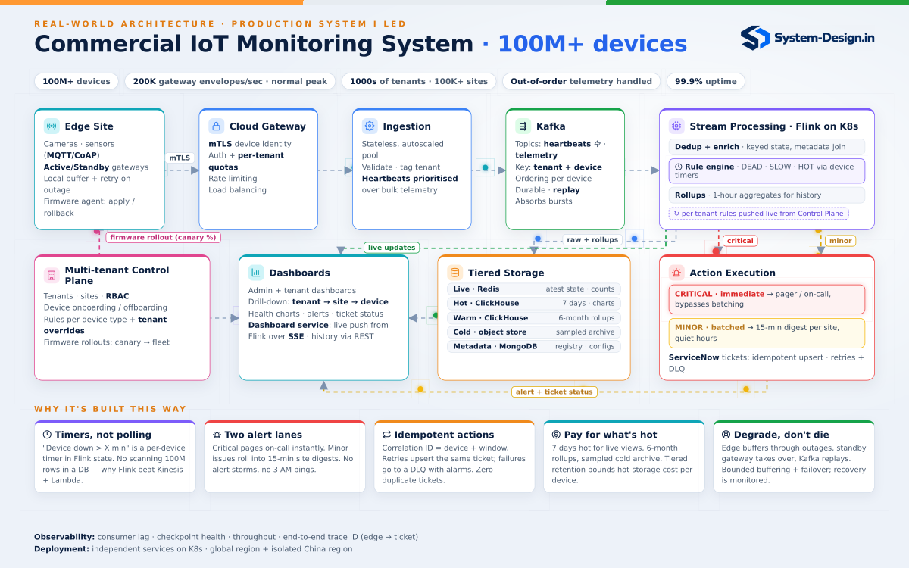

<a href="https://system-design.in"></a>

# IoT Architecture Walkthrough

By Pankaj Kapoor · [System-Design.in](https://system-design.in) · 1:1 system design mentoring

An interactive, click-to-advance walkthrough of a commercial IoT monitoring platform: **100M+ devices, 200K batched msgs/sec normal peak, 99.9% uptime**. By System-Design.in.

### ▶ [Open the interactive walkthrough](https://pakapoor.github.io/iot-architecture-walkthrough/)



## How to use it
Expand **Flows** or **Infra issues** and click a walkthrough directly, then press play or step through with the arrow keys. Each section reveals its items immediately; opening another section closes the previous one. Direct links open the selected section. Click or keyboard-activate a component for a close-up. In Tiered Storage, select a store to inspect its example schema. Two toggles add extra layers:
- **Observability** overlays the Datadog view.
- **Design decisions** adds the trade-offs behind each step.

## Flows
| Group | Flow | What it shows |
|---|---|---|
| Device data | Heartbeat | heartbeat → priority topic → Flink per-device timer → Redis → live status |
| | Telemetry | sensor → Kafka → Flink → live push over SSE + ClickHouse history |
| Alerts | Critical · field fix | DEAD → PagerDuty + Temporal → ServiceNow → escalate → field fix |
| | Critical · auto-resolve | device recovers → signal → ticket closes itself |
| | Critical · ServiceNow down | bounded retries → parked workflow → human replay → one ticket |
| | Minor · digest | SLOW → minor lane → 15-min digest per site |
| Multi-tenancy | Noisy neighbour | tenant throttled at its own quota, bounded tenant budgets; scoped identities and RBAC |
| Deployment & upgrades | Device firmware | canary 1% → health gates → waves → auto-halt + A/B rollback |
| | Gateway + Ingestion | stateless services, canary by traffic |
| | Flink jobs | stateful jobs upgraded via savepoints |
| | Temporal + Action services | new workflow versions never break running workflows |
| | Dashboard service + UI | feature flags, CDN and graceful SSE reconnects |
| | Data stores | zero-downtime schema change: expand → migrate → contract |
| | Kafka + platform | infrastructure as code, rolled one broker at a time |

| Infra issue | What it shows |
|---|---|
| Queue depth rising | burst → Datadog alert → automatic fix → DevOps runbook if it persists |
| Alert storm | one root cause, one page: correlate · suppress · auto-resolve |
| Flink job crash | checkpoint restore → Kafka replay → idempotent actions |
| Hot partition | contained at the door: per-device limits · lag by partition |
| Sustained 10× traffic | measure the bottleneck → scale each layer → ordered Kafka migration → bounded admission → recovery/soak gates |

**Deep dives** contains six runnable visual answers: delivery/replay, device versus pipeline health, incident races, tenant isolation, live/history consistency, and safe rollback. **Future enhancements** opens four updated architecture walkthroughs: predictive maintenance, fleet security triage, cross-site root-cause analysis, and a runbook copilot. Choose a future scenario to see its proposed components connected to the existing architecture, then use the main Play/Next controls. Click a new component for a close-up, or open Problem & trade-offs for supporting details. Deep dives retain their focused dialog playback. Every AI proposal identifies its model/GenAI step, evidence and human decision boundary. These are browser simulations, with no AI service or infrastructure commands connected.

Flows use keys 1–4 for their groups; infra issues use 5–9. Automatic playback offers a five-second Up next countdown after the final card. Manual stepping records explored progress without advancing. Phones highlight linked videos or show a desktop note for interactive-only flows; deep dives and future proposal details also run on phones, using the full updated architecture preview with the active component highlighted.

## Videos
Walkthrough videos of the first eight flows (720p), in [`videos/`](videos):

| | |
|---|---|
| [Critical alert · field fix](https://pakapoor.github.io/iot-architecture-walkthrough/videos/IoT_1_Red_Alert_Field_Fix.mp4) | [Critical alert · auto-resolve](https://pakapoor.github.io/iot-architecture-walkthrough/videos/IoT_2_Red_Alert_Auto_Resolve.mp4) |
| [Minor alert · digest](https://pakapoor.github.io/iot-architecture-walkthrough/videos/IoT_3_Yellow_Alert_Dashboard.mp4) | [Live telemetry dashboard](https://pakapoor.github.io/iot-architecture-walkthrough/videos/IoT_4_Live_Telemetry_Dashboard.mp4) |
| [ServiceNow down · parked + replay](https://pakapoor.github.io/iot-architecture-walkthrough/videos/IoT_5_ServiceNow_Down_Parked_Replay.mp4) | [Queue depth rising](https://pakapoor.github.io/iot-architecture-walkthrough/videos/IoT_6_Backlog_Lag_Rising.mp4) |
| [Health check](https://pakapoor.github.io/iot-architecture-walkthrough/videos/IoT_7_Health_Check.mp4) | [Multi-tenancy](https://pakapoor.github.io/iot-architecture-walkthrough/videos/IoT_8_Multi_Tenancy.mp4) |

## Repository layout
```
index.html                entry point for GitHub Pages (opens pres/)
pres/index.html           the one-page shell: side panel, toggles, design decisions, phone layout
pres/timeline2p.js        presenter engine: stops, camera, controls, close-ups, reflow
pres/icons.js             SVG line icons (replace emoji at runtime)
pres/deep-dives.js        visual interview answers and illustrative AI proposals
pres/flow*.html           one page per flow (generated)
iot.html, svcnow.html     the architecture diagram and ServiceNow/Temporal scene (source of truth)
vid/build.py              assembles each flow page; vid/cicd_data.py holds the CI/CD scenes
vid/render.py             renders a flow to MP4:  python3 vid/render.py <1-8> li
tools/build.sh            regenerates pres/flow*.html
tools/svgs.py             generator for the graphical close-ups (embedded in timeline2p.js)
tools/browser_check.py    browser regression suite, including every new scenario
tools/render_assets.py    refresh PNG previews, future architectures and vector diagram
vid/proposal_data.py      proposed component definitions and integrated walkthrough data
pres/proposals.js         generated future-scenario metadata
docs/architecture.svg     vector diagram for this README
videos/                   rendered walkthrough videos
```

## Build
```bash
./tools/build.sh                     # regenerate the flow pages
pip install playwright pymupdf && python3 -m playwright install chromium
python3 tools/browser_check.py       # browser checks; screenshots/results in /tmp
python3 tools/render_assets.py       # refresh screenshot and vector previews
```
It's plain static files, so it runs on GitHub Pages, Netlify or any web server, or you can open `pres/index.html` locally.

## Notes
- Operational scenarios are the failure modes the system was **designed for**.
- Database schemas, keys, role permissions and CI/CD tooling in the close-ups are **examples**, labelled as such.
- Additional recovery policies and AI components are design examples/proposals, not assertions that these exact implementations ran in production. The 500K recovery burst and sustained 10× growth are designed-for scenarios, not measured throughput benchmarks.
- The existing eight MP4s are earlier rendered snapshots. Current accuracy explanations and new scenarios are available in the interactive UI; regenerate videos separately when publishing a new video edition.
- `tools/build.sh` embeds generated close-ups, updates all 23 flow pages and derives the video timeline from the same interactive timeline definitions.
