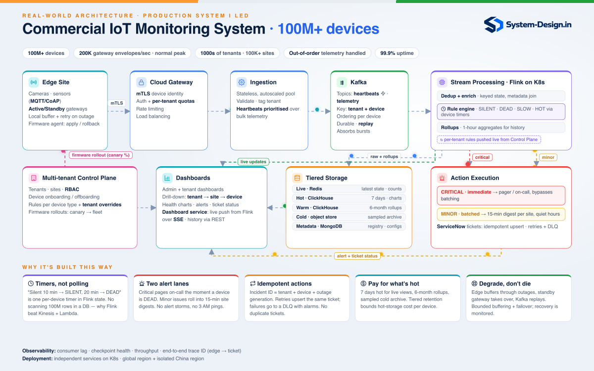

<a href="https://system-design.in"></a>

# IoT Architecture Walkthrough

By Pankaj Kapoor · [System-Design.in](https://system-design.in) · 1:1 system design mentoring

An interactive, click-to-advance walkthrough of a commercial IoT monitoring platform: **100M+ devices, 200K gateway envelopes/sec normal peak, 99.9% uptime**. By System-Design.in. Ingestion unpacks those envelopes; Kafka, Flink and storage handle device readings and bytes.

### ▶ [Open the interactive walkthrough](https://pakapoor.github.io/iot-architecture-walkthrough/)



## How to use it
The whole site opens in **dark mode**; the sun/moon button in the sidebar (or T) switches to light and is remembered. Every diagram, close-up and scene follows the choice.

The walkthrough opens on the **global deployment (HLD)**: AWS regions US East ↔ US West (CCPA) and EU Frankfurt ↔ EU Ireland (GDPR), coordinated by a global control plane (config out, aggregates in, DR only within a zone), plus an independent China deployment on Alibaba Cloud (PIPL). Click a deployment for its regional HLD; the big **Show detail** button opens the full architecture (LLD), where multi-instance services are drawn as stacked cards with their instance counts, and **← Global view** returns.

Open **My role** for the presenter's role, scope, decisions and outcomes, **Requirements** (Q) for the functional and non-functional requirements and the design decisions that meet them (each decision lists the requirements it serves, the rejected alternative and its trade-off), and **Glossary** (G) for plain-English definitions. Expand **Flows**, **Deep dives** or **Deployment & upgrades** and click a walkthrough directly, then press play or step through with the arrow keys. Each section reveals its items immediately; opening another section closes the previous one. Direct links open the selected section. Click or keyboard-activate a component for a close-up. In Tiered Storage, select a store to inspect its example schema; in Edge Site, select a site to open its example network. While a flow plays, the left panel explains each step with a heading and spoken bullets; clicking the component the ball rests on opens an animated view of what happens inside it. Trade-offs appear in a highlighted amber box in the panel; new stops also teach with a "What is it?" line and "If they ask…" follow-ups. Play runs at a presenter-friendly pace and ■ Stop holds the current step. The Datadog observability tiles are always shown. Clicking Edge Site opens the tenant view (with onboarding and site filtering); click a site for an example small-store or flagship network. A platform row under the diagram holds **Kubernetes · EKS** (cluster layout, with deeper views of scaling, the Kafka and Flink operators, and EKS vs ECS) and **Regions** (home regions, standby, and the edge → ingestion path across regions).

## Flows
| Group | Flow | What it shows |
|---|---|---|
| Device data | Heartbeat | heartbeat → priority topic → Flink per-device timer → Redis → live status |
| | Telemetry | sensor → Kafka → Flink → live push over SSE + ClickHouse history |
| Alerts | Critical · field fix | DEAD → PagerDuty + Temporal → ServiceNow → escalate → field fix |
| | Critical · auto-resolve | device recovers → signal → ticket closes itself |
| | Critical · ServiceNow down | bounded retries → parked workflow → human replay → one ticket |
| | Minor · digest | SLOW → minor lane → 15-min digest per site |
| Multi-tenancy | Noisy neighbour | tenant throttled at its own quota, bounded tenant budgets; scoped identities and RBAC |

**Deep dives · Kubernetes & platform**

| Flow | What it shows |
|---|---|
| Traffic spike scales out | HPA on CPU · KEDA on Kafka lag · Karpenter adds nodes · Flink rescales via savepoint · quotas cap a bad spike |
| Node / AZ dies | pods reschedule across AZs · Kafka in-sync replicas lead · Flink restores from checkpoint · UNKNOWN, not DEAD |
| Kafka & Flink on Kubernetes | Strimzi and the Flink Operator · StatefulSets, disks, PDBs · savepoint upgrades · Argo CD |
| EKS vs ECS | the platform decision: operators and portability vs a simpler managed service, and the cost we accepted |

**Deep dives · when things break**

| Infra issue | What it shows |
|---|---|
| Queue depth rising | burst → Datadog alert → automatic fix → DevOps runbook if it persists |
| Alert storm | one root cause, one page: correlate · suppress · auto-resolve |
| Flink job crash | checkpoint restore → Kafka replay → idempotent actions |
| Hot partition | contained at the door: per-device limits · lag by partition |
| Sustained 10× traffic | measure the bottleneck → scale each layer → ordered Kafka migration → bounded admission → recovery/soak gates |
| Region outage → failover | spools buffer → UNKNOWN, not DEAD → in-zone failover → same incident IDs → rehearsed RPO/RTO and fail-back |

**Deep dives** also contains seven runnable visual answers on correctness and trade-offs: delivery/replay, device versus pipeline health, incident races, tenant isolation, live/history consistency, safe rollback, and data residency (home region per tenant, along the edge → ingestion path). Each is a flow on the main architecture diagram (flows 20–26), with presenter notes and inside views like the other walkthroughs; old `?deep=` links open the matching flow.

| Deployment & upgrades | What it shows |
|---|---|
| Device firmware | canary 1% → health gates → waves → auto-halt + A/B rollback |
| Gateway + Ingestion | stateless services, canary by traffic |
| Flink jobs | stateful jobs upgraded via savepoints |
| Temporal + Action services | new workflow versions never break running workflows |
| Dashboard service + UI | feature flags, CDN and graceful SSE reconnects |
| Data stores | zero-downtime schema change: expand → migrate → contract |
| Kafka + platform | infrastructure as code, rolled one broker at a time |

Flows use keys 1–3 for their groups, deployment uses 4 and infra issues use 5–9; R opens My role, Q Requirements, G Glossary. Automatic playback offers a five-second Up next countdown after the final card. Manual stepping records explored progress without advancing. Phones highlight linked videos or show a desktop note for interactive-only flows; deep dives also run on phones.

## Videos
Walkthrough videos of the first eight flows (720p), in [`videos/`](videos):

| | |
|---|---|
| [Critical alert · field fix](https://pakapoor.github.io/iot-architecture-walkthrough/videos/IoT_1_Red_Alert_Field_Fix.mp4) | [Critical alert · auto-resolve](https://pakapoor.github.io/iot-architecture-walkthrough/videos/IoT_2_Red_Alert_Auto_Resolve.mp4) |
| [Minor alert · digest](https://pakapoor.github.io/iot-architecture-walkthrough/videos/IoT_3_Yellow_Alert_Dashboard.mp4) | [Live telemetry dashboard](https://pakapoor.github.io/iot-architecture-walkthrough/videos/IoT_4_Live_Telemetry_Dashboard.mp4) |
| [ServiceNow down · parked + replay](https://pakapoor.github.io/iot-architecture-walkthrough/videos/IoT_5_ServiceNow_Down_Parked_Replay.mp4) | [Queue depth rising](https://pakapoor.github.io/iot-architecture-walkthrough/videos/IoT_6_Backlog_Lag_Rising.mp4) |
| [Health check](https://pakapoor.github.io/iot-architecture-walkthrough/videos/IoT_7_Health_Check.mp4) | [Multi-tenancy](https://pakapoor.github.io/iot-architecture-walkthrough/videos/IoT_8_Multi_Tenancy.mp4) |

## Repository layout
```
index.html                entry point for GitHub Pages (opens pres/)
pres/index.html           the one-page shell: side panel, dialogs, home view (global HLD), phone layout
pres/hld.html             global and regional HLDs (generated by tools/hld.py)
pres/timeline2p.js        presenter engine: stops, camera, controls, close-ups, reflow
pres/icons.js             SVG line icons (replace emoji at runtime)
pres/notes.js             explanation-panel notes + inside views: flow 1 and registerFlow()
pres/notes-*.js           the other flows' notes: alerts, device, infra, deploy, lessons (flows 20–25), regions (flows 26–27), k8s-a/k8s-b (Kubernetes, flows 28–31; these define their own stops via FLOWDEF)
pres/requirements.js      FRs, NFRs and design decisions (Requirements dialog)
pres/glossary.js          plain-English glossary (Glossary dialog)
pres/role.js              content of the My role dialog
pres/theme.js             dark theme for flow pages and the HLD (remaps colour lightness, keeps hue)
pres/flow*.html           one page per flow (generated)
iot.html, svcnow.html     the architecture diagram and ServiceNow/Temporal scene (source of truth)
vid/build.py              assembles each flow page; vid/cicd_data.py holds the CI/CD scenes
vid/render.py             renders a flow to MP4:  python3 vid/render.py <1-8> li
tools/build.sh            regenerates pres/flow*.html
tools/svgs.py             generator for the graphical close-ups (embedded in timeline2p.js)
tools/hld.py              generator for pres/hld.html (run by tools/build.sh)
tools/browser_check.py    browser regression suite, including every new scenario
tools/render_assets.py    refresh PNG previews and the vector diagram
docs/architecture.svg     vector diagram for this README
videos/                   rendered walkthrough videos
```

## Build
```bash
./tools/build.sh                     # regenerate the flow pages
pip install playwright pymupdf && python3 -m playwright install chromium
python3 tools/browser_check.py       # browser checks; screenshots/results in /tmp
python3 tools/render_assets.py       # refresh screenshot and vector previews
```
It's plain static files, so it runs on GitHub Pages, Netlify or any web server, or you can open `pres/index.html` locally.

## Notes
- Operational scenarios are the failure modes the system was **designed for**.
- Database schemas, keys, role permissions and CI/CD tooling in the close-ups are **examples**, labelled as such.
- Additional recovery policies are design examples, not assertions that these exact implementations ran in production. The 500K recovery burst and sustained 10× growth are designed-for scenarios, not measured throughput benchmarks.
- The existing eight MP4s are earlier rendered snapshots. Current accuracy explanations and new scenarios are available in the interactive UI; regenerate videos separately when publishing a new video edition.
- `tools/build.sh` embeds generated close-ups, updates all 31 flow pages and derives the video timeline from the same interactive timeline definitions.
